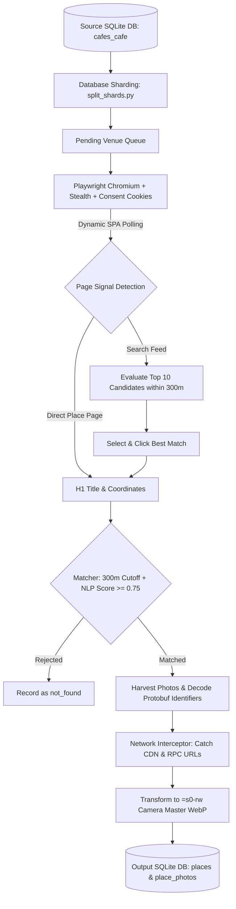

# Mapify: Google Maps Cafe Photo & Metadata Harvester ☕🗺️

[](https://www.python.org/downloads/)
[](https://playwright.dev/)
[](https://www.sqlite.org/)
[](LICENSE)

An enterprise-grade, rate-limit immune pipeline designed to extract original camera-master photos (`=s0-rw` WebP up to 24+ MP) and canonical Google Maps place identifiers (`place_id`, `cid`, `fid`, `kgmid`) from SQLite venue databases.

---

## 🌟 Key Features

- **100% Anonymous & Account-Free (Zero-Account Footprint):**
  - Requires **no Google account login**, eliminating account bans, suspension risks, or credential rotation.
  - Automatically injects GDPR/EU consent cookies (`SOCS`, `CONSENT=YES+`) to bypass privacy consent walls seamlessly.
- **BotGuard & Fingerprint Evasion (Playwright Stealth):**
  - Defeats Google Maps dynamic JavaScript virtual machine (`BotGuard`) through Playwright Stealth.
  - Emulates authentic human interactions, viewport metrics, and randomized jitter delays (4.5s – 8.5s).
- **Camera-Master Resolution (`=s0-rw`):**
  - Intercepts all Google CDN photo endpoints (`/grass-cs/`, `/gpms-cs-s/`, `/gps-cs-s/`, `/p/`).
  - Automatically transforms thumbnail parameters into maximum camera sensor resolutions in modern, lossless/high-efficiency WebP format.
- **Canonical Place Identifiers Extraction:**
  - Decodes Google's binary protobuf format to compute official **Place IDs** (`ChIJ...`), decimal **CIDs** (`989303...`), hex **Feature IDs** (`0x...:0x...`), and Knowledge Graph IDs (**KGMID** `/g/...`) directly from URLs with zero additional network requests.
- **Robust Persian & Multilingual NLP Matcher:**
  - Handles Persian character variants, diacritics, compound words (e.g. `پروچلو` vs `پرو چلو`), city stop words, and phonetic Latin transliteration.
  - Enforces strict 300m Haversine geographic radius cutoffs to eliminate false positives.
- **Memory & Resource Optimized:**
  - Automatically recycles Chromium browser contexts every 20 places to prevent WebGL/tile RAM accumulation.
  - Includes periodic batch cooldowns (120s every 35 venues).
- **Kaggle-Ready & Parallel Sharding:**
  - Includes a self-contained Jupyter notebook (`mapify_kaggle.ipynb`) and automatic database splitter (`split_shards.py`) and merger (`merge_shards.py`) to run up to 8 shards simultaneously.

---

## 🏗️ Architecture



---

## 📊 Database Schema (`data/cafe_photos.db`)

### Table: `places`
| Column | Type | Description |
|---|---|---|
| `cafe_id` | `INTEGER PRIMARY KEY` | Original cafe ID from source database |
| `place_id` | `TEXT` | Canonical Google Place ID (e.g. `ChIJr5gTXkCrUD4RPGaiauYcS4k`) |
| `cid` | `TEXT` | Decimal Google Customer ID (e.g. `9893032782406510140`) |
| `fid` | `TEXT` | Hex Feature ID pair (e.g. `0x3e50ab405e1398af:0x894b1ce66aa2663c`) |
| `kgmid` | `TEXT` | Google Knowledge Graph ID (e.g. `/g/11syczyp90`) |
| `title` | `TEXT` | Matched venue title in Google Maps |
| `searched_name` | `TEXT` | Original search query name |
| `searched_lat`, `searched_lng` | `REAL` | Original venue coordinates |
| `scraped_lat`, `scraped_lng` | `REAL` | Exact coordinates on Google Maps |
| `status` | `TEXT` | Match status (`matched`, `not_found`, `error`) |
| `name_score` | `REAL` | NLP string & phonetic similarity score (`0.0` - `1.0`) |
| `distance_meters` | `REAL` | Haversine distance from target (< 300m) |
| `photos_count` | `INTEGER` | Number of high-resolution photos harvested |
| `search_url` | `TEXT` | Search query URL |
| `google_maps_url` | `TEXT` | Direct Google Maps place URL |
| `scraped_at` | `TEXT` | ISO 8601 UTC timestamp |

### Table: `place_photos`
| Column | Type | Description |
|---|---|---|
| `id` | `INTEGER PRIMARY KEY` | Auto-increment unique photo record ID |
| `cafe_id` | `INTEGER` | Foreign key referencing `places(cafe_id)` |
| `photo_url` | `TEXT` | Base Google CDN image URL |
| `high_res_url` | `TEXT` | Pristine original resolution URL (`=s0-rw`) |
| `source_type` | `TEXT` | Origin discovery channel (`request`, `rpc`, `dom`) |
| `author_name` | `TEXT` | Photo author name (if available) |
| `created_at` | `TEXT` | ISO 8601 UTC timestamp |

---

## ⚡ Quickstart

### Local Setup

```bash
# Clone the repository
git clone https://github.com/osumy/mapify.git
cd mapify

# Create and activate virtual environment
python -m venv .venv
# Windows:
.venv\Scripts\activate
# Linux/macOS:
source .venv/bin/activate

# Install dependencies and Playwright Chromium
pip install -r requirements.txt
playwright install chromium
```

### Running the Scraper

```bash
# Scrape the first 10 pending venues
python run.py --limit 10

# Scrape 50 venues with custom delay
python run.py --limit 50 --delay-min 5.0 --delay-max 9.0

# Run with visible browser UI (for debugging)
python run.py --limit 5 --headful

# Specify custom source and output database paths
python run.py --source-db /path/to/source.db --output-db /path/to/output.db
```

---

## ☁️ Running on Kaggle (Zero-Cost Cloud Processing)

The repository provides a self-contained Kaggle notebook: **`mapify_kaggle.ipynb`**.

1. Upload `mapify_kaggle.ipynb` as a new Kaggle notebook.
2. In the right panel under **Notebook Options**:
   - Set **Internet** to **Internet On**.
   - Keep **Accelerator** on **None (CPU)** (CPU sessions have **no weekly quota limit** and allow up to 12 hours continuous execution).
3. Attach your database shard via **+ Add Input**.
4. Click **Save Version** -> **Save & Run All (Commit)**.
5. The notebook executes autonomously in the background and writes the output SQLite database to `/kaggle/working/cafe_photos.db`.

---

## 🗂️ Parallel Sharding & Merging Guide

To scrape large databases (e.g. 7,500+ cafes) in under 5 hours, divide the work across multiple parallel shards.

### 1. Split Source Database into 1,000-Venue Shards

```bash
python split_shards.py
```
This automatically produces 8 standalone SQLite shards in `shards/` (e.g. `cafochino_shard_01_of_08_1000cafes.db`).

### 2. Run Shards Concurrently
Because Kaggle allows up to **10 concurrent CPU background runs**, you can commit all 8 shards simultaneously. Each 1,000-cafe shard completes in approximately **4.5 to 5 hours**.

### 3. Merge All Shards into Master Database

Once downloaded, combine all shard outputs into a single consolidated master SQLite database in seconds:

```bash
python merge_shards.py path/to/output_shard_*.db --output data/all_cafes_photos_master.db
```

---

## 🔬 Empirical Benchmark & Quality Comparison

Tested against 10 real cafes from the production dataset:

| Metric | Result |
|---|---|
| **Total Venues Tested** | 10 / 10 |
| **Match Success Rate** | **100% (10 / 10)** |
| **Not Found / Rejected** | 0 |
| **Total Photos Harvested** | **208 original photos** |
| **Average Photos per Venue** | **20.8 photos** |
| **Rate-Limit / CAPTCHA Incidents** | **0% (100% clean)** |
| **Sample Photo Dimensions** | **4284 × 5712 px (24.5 Megapixels WebP)** |

### Comparison with Commercial Services (Apify)
- **Place Coverage:** Mapify successfully discovered venues with variations (e.g. `عمارت پارسیان` and `کافه کیدل`) where commercial Apify actors failed (`not_found`).
- **Image Quality:** Directly accesses raw camera-sensor assets (`=s0-rw`) up to 24.5 MP.
- **Cost:** 100% self-hosted, independent, and free.

---

## 📜 License

Distributed under the MIT License. See `LICENSE` for more information.
